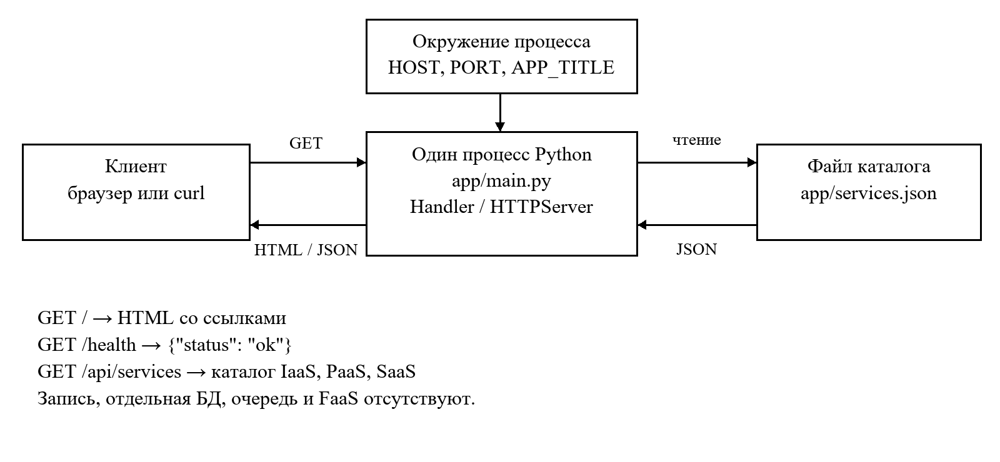

# Архитектура облачного приложения Cloud Service Catalog

Архитектурный анализ по лекции № 5. Автор: Сазонов Даниил Евгеньевич.

## Понятие архитектуры

Архитектура задаёт компоненты, их ответственность, интерфейсы, владение данными и способ эксплуатации. Для облачного приложения к структуре кода добавляются сетевые задержки, частичные отказы, масштабирование и стоимость ресурсов. Размещение программы на одной виртуальной машине само по себе не обеспечивает эластичность или высокую доступность.

## Монолит и модульный монолит

Монолит разрабатывается и развёртывается как одна единица. Вызовы между его частями выполняются внутри процесса, поэтому локальная отладка и проверка проще, а сетевых зависимостей меньше. Единая база, если она используется, позволяет выполнять локальные транзакции. При росте связанности изменение небольшой функции требует проверки и выпуска всего приложения; отдельно масштабировать только эту функцию трудно. Монолит пригоден для небольших команд и ограниченной предметной области.

Модульный монолит сохраняет единое развёртывание, но вводит явные функциональные границы и интерфейсы. Модули не должны произвольно обращаться к внутренним структурам друг друга. Это позволяет подготовить границы будущих сервисов без брокера и межсервисной сети. Наличие нескольких папок само по себе не означает модульную архитектуру.

## Микросервисы и владение данными

Микросервис выделяют по бизнес-ответственности, а не по количеству строк. Автономность требует стабильного контракта API, собственной логики, контролируемых данных, независимого выпуска и масштабирования. Например, каталог, оплата и уведомления могут иметь разные нагрузки и графики изменений. Выгода возникает, когда эти различия оправдывают дополнительные развёртывания, мониторинг и поддержку интерфейсов.

Прямой доступ нескольких сервисов к общим таблицам связывает их со схемой хранения и затрудняет независимые изменения. Предпочтительно обращаться к владельцу данных через API или события. Межсервисная операция при этом не становится одной обычной транзакцией: возможны промежуточные состояния, повторная доставка и компенсации. Согласованность может быть eventual consistency; её допустимость определяется бизнес-требованиями. Отдельные сервисы не гарантируют изоляцию отказов без тайм-аутов и ограничения каскадных вызовов.

## Синхронное и асинхронное взаимодействие

В синхронном HTTP или RPC вызывающая сторона ожидает результат. Это подходит для запроса текущего каталога, но требует доступности получателя в момент обращения. Нужны тайм-ауты, ограниченное число повторов и различение временной ошибки и окончательного отказа. Повторы операций записи безопасны только при обеспеченной идемпотентности.

При асинхронном взаимодействии отправитель помещает сообщение в очередь, а обработчик выполняет его позднее. Очередь сглаживает всплески нагрузки и позволяет пережить краткую недоступность потребителя, пока хватает её ёмкости. Подтверждение приёма сообщения не означает завершение операции. Нужны идентификаторы сообщений, правила повторов, дедупликация, обработка необрабатываемых сообщений и наблюдение за задержкой очереди.

## Serverless и FaaS

В serverless провайдер управляет выделением вычислительных ресурсов и значительной частью инфраструктуры. Серверы существуют; разработчик отвечает за логику, разрешения, данные и конфигурацию. FaaS — частный случай: функция запускается событием, обрабатывает его и завершает выполнение. Триггерами бывают HTTP-запрос, очередь, загрузка объекта, изменение записи или расписание.

Модель удобна для нерегулярной нагрузки и коротких обработчиков. Следует оценить холодный старт, ограничения времени и памяти, доступ к сети, параллелизм, сложность локальной отладки и зависимость от платформы. Стоимость зависит от вызовов, времени выполнения и связанных сервисов; serverless не обязательно дешевле постоянно загруженного сервера. Долговременное состояние следует хранить вне временной среды функции.

## Событийно ориентированная архитектура

Событие сообщает о произошедшем факте, например «каталог обновлён». Производитель публикует его, а подписчики могут независимо обновить поисковый индекс или отправить уведомление. Добавление потребителя обычно не требует изменения производителя, если контракт события сохраняется. EDA сочетается с микросервисами и FaaS, но не требует их во всех частях системы.

Цена слабой связанности — задержка между фактом и его обработкой, возможные дубликаты и нарушение порядка. Потребителю нужны идемпотентность, версия схемы и способ восстановления обработки. Для диагностики полезны корреляционные идентификаторы, метрики задержки и журнал ошибок. В текущем каталоге нет операций записи и фоновых задач, поэтому брокер событий не нужен.

## Другие модели и эксплуатация

Трёхуровневая модель разделяет представление, прикладную логику и данные; логические уровни не обязательно размещаются на разных серверах. SOA организует интеграцию через сервисы и часто использует более крупные границы и централизованные интеграционные механизмы. Управляемые базы, очереди и хранилища уменьшают объём обслуживания инфраструктуры, но требуют настройки доступа, резервирования и оценки стоимости.

Контейнер упаковывает приложение и зависимости и использует ядро хоста. Он не превращает монолит в микросервисы. Cloud-native охватывает автоматизацию, наблюдаемость, эластичность и устойчивость к отказам; одного контейнера или ВМ недостаточно. Пример обработки файлов из лекции показывает подход к проектированию, но не является развёрнутой частью Cloud Service Catalog.

## Практический разбор Cloud Service Catalog

Выбран простой монолит: единственный процесс Python обрабатывает запросы через ThreadingHTTPServer. Handler в app/main.py выбирает маршрут, app/services.json хранит каталог. GET / возвращает HTML со ссылками, GET /health — JSON о доступности процесса, GET /api/services — содержимое файла; неизвестный путь возвращает 404. На запрос каталога приходится чтение локального файла. Записи через API нет, данные обновляются вместе с исходным кодом через Git.

HOST, PORT и APP_TITLE читаются из окружения процесса. config/example.env — пример, а не автоматически загружаемый файл. Заголовок HTML экранируется; ответы содержат Content-Length и X-Content-Type-Options. API не использует базу данных, очередь, авторизацию или функции FaaS. Наличие HTTP API не делает приложение микросервисной системой. Для одного автора, трёх маршрутов и небольшого каталога отдельные сервисы увеличили бы сопровождение без проверенной потребности.

## Предлагаемое масштабирование и отказоустойчивость

Сначала следует измерить частоту запросов, время ответа и расход памяти. При необходимости несколько одинаковых экземпляров можно разместить за балансировщиком: пользовательских сессий и записи на диск нет. Все реплики должны получать одну проверенную версию каталога; обновление выполняется выпуском версии с возможностью отката. При появлении изменяемых данных потребуется отдельное хранилище и продуманная модель согласованности.

Для доступности нужны экземпляры в разных доменах отказа: два процесса на одной ВМ не защищают от отказа этой ВМ. Процесс можно перезапускать менеджером служб; развёртывание должно проверять ответы и уметь возвращать предыдущую версию. /health отражает только доступность процесса и не проверяет чтение каталога. Для готовности к трафику требуется отдельная проверка данных; для наблюдения — HTTP-ошибки, задержки, ресурсы и журнал запросов. Эти меры являются проектом развития, а не результатом нагрузочного испытания или реально настроенным кластером.

## Предлагаемые меры безопасности

Текущий сервер стандартной библиотеки предназначен для учебной среды. Для публичной эксплуатации следует выбрать подходящий серверный стек, настроить TLS на входе, ограничения запросов, обновления зависимостей и минимальные сетевые разрешения. Процесс должен работать без root, данные каталога — быть доступны только для чтения. Для будущих операций изменения понадобятся аутентификация, авторизация и проверка входных данных.

Секреты передаются отдельно от Git и образа; права доступа выдаются по необходимости. Публичный репозиторий не должен содержать закрытые ключи и локальные файлы окружения. Резервная копия и проверка восстановления нужны для изменяемых данных; для текущего статического каталога Git фиксирует версии, но восстановление среды всё равно требуется документировать.

## Схема текущего приложения

Схема отражает код приложения; это не снимок экрана развёрнутой системы.

## Сравнение моделей

| Модель | Выпуск и масштабирование | Цена подхода | Применение |
|---|---|---|---|
| Монолит | Один выпуск и процесс; масштабируется целиком | Низкая начальная сложность; риск связанности | Малый проект, один автор |
| Модульный монолит | Один выпуск, строгие внутренние интерфейсы | Границы требуют дисциплины | Рост функциональности без независимых команд |
| Микросервисы | Независимые сервисы и хранилища | Сеть, контракты, распределённые отказы | Разные нагрузки и команды |
| Serverless / FaaS | Функция или управляемый компонент | Лимиты платформы, cold start, зависимость | Короткие событийные задачи |

## Контрольные вопросы

### 1. Что понимается под архитектурой облачного приложения?

Это правила построения компонентов, интерфейсов, данных и эксплуатации системы. В облаке они дополнительно учитывают распределённость, масштабирование, стоимость и отказы инфраструктуры.

### 2. В чем состоят основные различия монолитной и микросервисной архитектур?

Монолит выпускается как единое приложение и обычно использует внутрипроцессные вызовы. Микросервисы имеют независимые единицы выпуска и сетевые контракты. Это даёт выборочное масштабирование, но повышает сложность согласованности и эксплуатации.

### 3. Какие свойства обеспечивают автономность микросервиса?

Ограниченная бизнес-ответственность, высокая связность внутри, слабые внешние зависимости, стабильный API, контроль данных и независимые тестирование, выпуск и масштабирование. Общая изменяемая схема хранения может нарушить эту автономность.

### 4. Чем синхронное взаимодействие сервисов отличается от асинхронного?

При синхронном вызове отправитель ожидает ответ и зависит от текущей доступности получателя. Асинхронное сообщение может обрабатываться позже; отправителю нужно отдельно узнать результат, а системе — управлять повторами и задержками.

### 5. Почему микросервисам рекомендуется контролировать собственные данные?

Контроль данных позволяет изменять внутреннюю схему без прямого воздействия на соседние сервисы. Другие компоненты используют контракт владельца. При этом согласованность между сервисами требует явных процессов, событий или компенсационных операций.

### 6. Что означает термин serverless и почему он не означает отсутствие серверов?

Serverless переносит управление вычислительной инфраструктурой на провайдера. Физические серверы остаются, но их подготовка и масштабирование скрыты за сервисом. Разработчик сохраняет ответственность за код, данные и разрешения.

### 7. Что такое FaaS и какие события могут инициировать выполнение функции?

Function as a Service выполняет функцию по событию. Её могут вызвать HTTP, сообщение очереди, загрузка файла, изменение данных и таймер. Среда выполнения ограничена правилами платформы, поэтому длительное состояние выносят наружу.

### 8. В чем преимущества и ограничения событийно-ориентированной архитектуры?

EDA разделяет производителя и потребителей, поддерживает независимую обработку и сглаживает пики. Ограничения — задержанная согласованность, повторы, порядок событий и сложная трассировка; нужны идемпотентность и наблюдаемость.

### 9. Чем модульный монолит отличается от классического монолита и микросервисной системы?

Модульный монолит имеет формальные внутренние границы и интерфейсы, но остаётся одной единицей развёртывания. Классический монолит не обязательно обеспечивает такие границы. Микросервисы дополнительно разделяют выпуск и взаимодействуют по сети.

### 10. Какие критерии необходимо учитывать при выборе архитектуры облачного приложения?

Оценивают нагрузку и её колебания, размер и опыт команды, сроки, частоту независимых изменений, доступность, требования к данным, безопасность, эксплуатационные затраты и зависимость от провайдера. Для данного небольшого каталога приоритетны простота и воспроизводимость.

## Вывод

Простой монолит соответствует текущим требованиям. При росте сначала полезны чёткие внутренние границы, измерения и автоматизация. Микросервисы, EDA и FaaS следует вводить для конкретной независимой нагрузки, а не ради названия архитектуры.

Источник анализа: предоставленная преподавателем лекция № 5 «Архитектура облачных приложений: микросервисы, serverless и другие модели».
